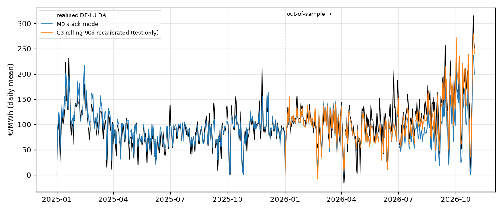
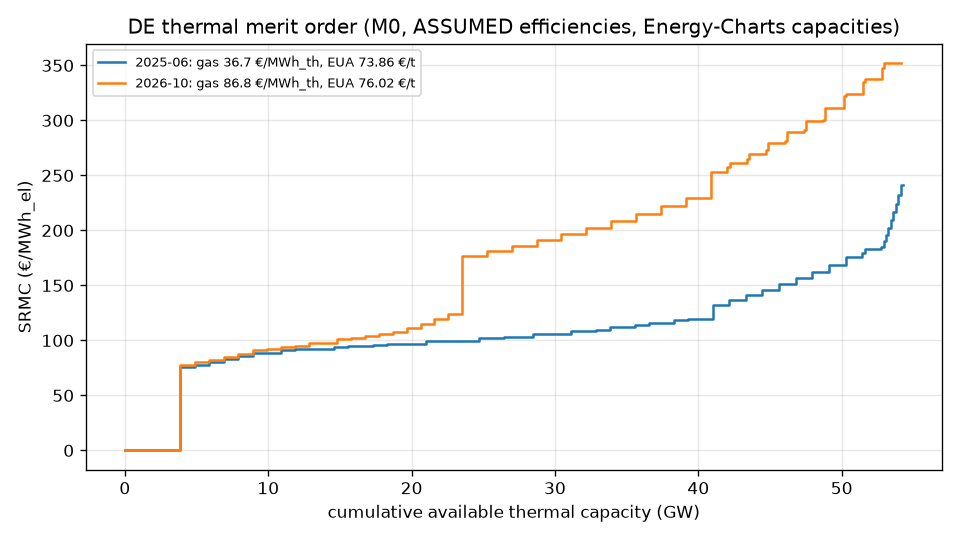
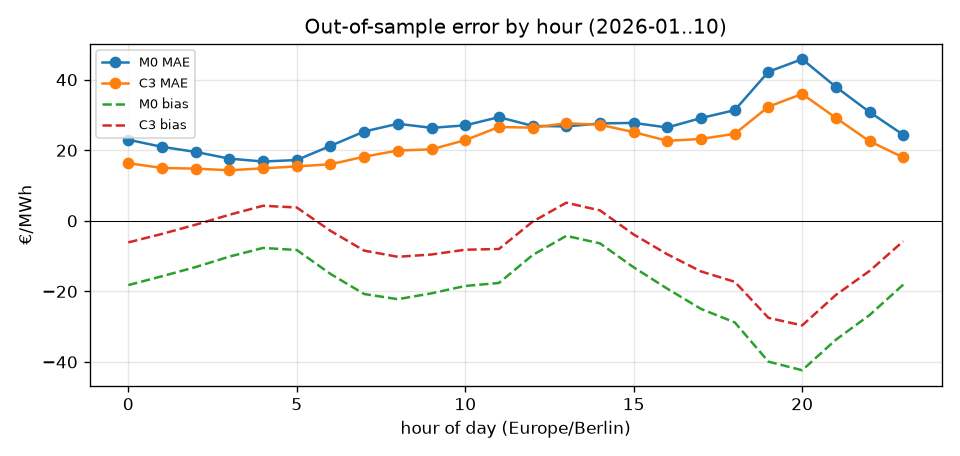

# epm-merit-order-model

**Step 2** of the [European Power Market Lab](https://github.com/DataWithSyed/eu-power-market-lab): a transparent, stack-based **fundamental model of the DE-LU day-ahead price**, built on real public data and scored hour by hour against realised prices, with honest out-of-sample tests.



## Problem

How much of the German day-ahead price does a plain merit order explain? That means fuel and carbon costs, thermal capacities and residual load, with no statistical fitting. Where does it fail (negative-price hours, scarcity hours, regime shifts), and does a simple calibration help **out of sample**?

## Method

1. **Data** (reused from step 1, [`epm-data-pipeline`](https://github.com/DataWithSyed/epm-data-pipeline); the fetch code is adapted in `src/meritorder/data.py` with extra series): Energy-Charts hourly DE-LU DA price and DE public net generation / load / residual load / cross-border trade (CC BY 4.0), 2025-01-01 → 2026-10-31, **16,056 hours**. Monthly World Bank Pink Sheet gas (Europe), coal (South Africa) and Brent, ECB USD/EUR, and a DEHSt German auction-average EUA proxy (73.86 €/t 2025; 76.02 €/t 2026 H1). Installed thermal capacity comes from Energy-Charts yearly stock (2025: lignite 14.78 GW, hard coal 15.21 GW, gas 35.35 GW, oil 3.58 GW).
2. **Stack** (`fleet.py`, `model.py`): five technologies (lignite, hard coal, gas CCGT, gas peaker/steam, oil). Each is split into 10 efficiency bands across an **ASSUMED** efficiency range. Band SRMC = fuel/η + EF/η · EUA + VOM. CO₂ factors are the IPCC 2006 defaults. A **thermal must-run** block (2 % quantile of observed 2025 output per fuel: lignite 2.47 GW, gas 1.06 GW, coal 0.25 GW, oil 0.09 GW) bids at the surplus price.
3. **Clearing**: residual load (load − wind − solar) minus observed must-run supply (biomass, hydro, waste, geothermal, others, coal-derived gas) clears against the stack. The price is the marginal band's SRMC, interpolated within the band. Demand ≤ 0 clears at 0 €/MWh.
4. **Variants** (calibrated on **2025**, tested on **2026-01 → 2026-10**):
   - `M0_stack`: textbook stack, isolated zone (main spec)
   - `M0_trade_exog`: same stack, but with realised net imports and pumped-storage output subtracted from demand
   - `C1_linear_2025`: static linear markup `a + b·M0` fitted on 2025
   - `C2_structural_2025`: 2,250-point grid over availability scale, efficiency shift, surplus price and scarcity adder (u₀, γ), fitted on 2025
   - `C3_rolling90_linear`: `a + b·M0` refitted **before each test month** on the trailing 90 days (strictly out of sample)
   - Benchmarks: `B1` flat CCGT SRMC (η = 0.50) and `B2` OLS of price on residual demand + CCGT SRMC (fit on 2025)

## Key measured results

All numbers come from `python scripts/run_model.py` (see `results/summary.json` and `results/metrics_summary.csv`). Realised DA mean: 89.32 €/MWh in 2025 (train) and 114.00 €/MWh in 2026-01..10 (test). 6.5 % of test hours had negative prices.

| Variant | Test MAE | Test RMSE | Test bias | Test corr | Train MAE |
|---|---:|---:|---:|---:|---:|
| M0 stack (uncalibrated) | 27.06 | 42.47 | −18.96 | 0.840 | 17.65 |
| M0 with realised trade exogenous | 35.94 | 51.71 | −12.13 | 0.752 | 29.61 |
| C1 linear markup (2025) | 29.54 | 44.68 | −23.50 | 0.840 | 17.24 |
| C2 structural grid (2025) | 29.12 | 44.53 | −22.98 | 0.840 | 17.02 |
| **C3 rolling-90d recalibration** | **22.07** | **36.41** | **−7.65** | **0.863** | — |
| B1 flat CCGT SRMC | 50.27 | 74.31 | +31.08 | 0.309 | 37.46 |
| B2 OLS residual load + SRMC | 38.61 | 53.18 | −31.35 | 0.793 | 17.53 |

Findings:

- **The plain stack explains most of the hourly price.** With no fitting at all, M0 reaches correlation 0.84 in both years and MAE 17.7 €/MWh in 2025. Out of sample in 2026 it beats the statistically fitted OLS benchmark (MAE 27.1 vs 38.6), because the OLS coefficients do not carry over when gas rises from ~33 to ~87 €/MWh_th. The structural model passes fuel prices through mechanically.
- **Calibrating on one year made the out-of-sample result worse.** Static 2025 calibrations (C1, C2) lowered train MAE but raised test MAE (29.5 / 29.1 vs 27.1). Only rolling recalibration helped, cutting test MAE by **18 %** (27.1 → 22.1) and bias from −19.0 to −7.7.
- **Main failure mode: underpricing in H2-2026.** M0 bias was −29 to −43 €/MWh in Jun–Oct 2026 (correlation still 0.75–0.92). Errors are worst in the evening ramp (hours 19–21: MAE 42–46, bias −40). As gas costs rose, the textbook stack has coal and lignite marginal in too many hours, so it misses scarcity / opportunity-cost pricing.
- **Regimes.** In the top-5 % price hours (mean 272.8 €/MWh) M0 averages 204.9 (bias −67.9), and C3 averages 238.2 (bias −34.6). The model predicts too many surplus hours: 1,526 vs 497 realised hours ≤ 0 €/MWh, so precision is 0.33 at recall 1.00. That is because exports, storage and curtailment absorb surplus that the isolated stack cannot.
- **Treating realised trade as exogenous hurts** (MAE 35.9, corr 0.75). Cross-border flows respond to price: Germany imports exactly when its price is high. Subtracting realised imports therefore flattens the demand that the price is supposed to reflect.

| Figure | |
|---|---|
|  |  |
| Merit order Jun-2025 vs Oct-2026 | Out-of-sample MAE / bias by hour |

More detail: `results/by_month_*.csv`, `results/by_hour_*.csv`, `results/by_regime_*.csv`, `results/structural_grid_top25.csv`, `figures/03_scatter_test.png`, and hourly model prices in `results/hourly_model_prices.csv.gz`.

## How to run

```bash
python -m venv .venv && source .venv/bin/activate
pip install -r requirements.txt
python scripts/fetch_data.py --start 2025-01-01 --end 2026-10-31   # optional: re-fetch (processed panel is shipped)
python scripts/run_model.py                                         # ~45 s on a laptop
pytest -q
```

## Tests

`pytest -q`: **17 passed**. They cover IPCC factors, stack ordering and capacity accounting, hand-checked SRMC, clearing edges and monotonicity, scarcity adder, fuel and carbon sensitivities, demand definitions, the out-of-sample guarantee of the rolling recalibration (future shocks cannot change earlier months), metrics, the DST-safe parser, the licence gate and processed-panel sanity.

## Assumptions

Everything that is not observed is labelled **ASSUMED** in [`docs/assumptions.md`](docs/assumptions.md). This covers efficiency bands, availabilities, VOM, fuel adders, lignite fuel cost, the oil heat-content conversion and the must-run rule. The CO₂ factors are the IPCC 2006 Guidelines Vol. 2 Ch. 2 Table 2.2 defaults (verified against the PDF).

## Limitations

- Fuels are **monthly** Pink Sheet benchmarks, not daily TTF / API2 settlements. The EUA input is an **annual/H1 auction average**, not daily futures. This alone flattens intra-month variation.
- Pink Sheet gas is per MMBtu (calorific basis not harmonised), and the IPCC factors are on a net-calorific basis. That is roughly a 10 % gas-cost ambiguity, absorbed by the calibration variants.
- There are no unit-level outages, start-up costs, ramping, CHP heat constraints, reserve holdings or hydro/storage opportunity costs, and no cross-border coupling. Imports enter only implicitly through calibration.
- Hard coal availability (0.65) reflects units held in reserve or out of the market as a rough fleet-level ASSUMPTION, not a unit list.
- Public net generation excludes most industrial self-generation and behind-the-meter batteries, so load in the panel and true demand differ by a few GW.
- Hourly values are means of 15-minute data. This is an explanatory **back-cast** using realised residual load, not a forecast (that is step 5).

## Related work

- Umbrella and roadmap: [eu-power-market-lab](https://github.com/DataWithSyed/eu-power-market-lab)
- Step 1 data: [epm-data-pipeline](https://github.com/DataWithSyed/epm-data-pipeline)
- Prior single-repo studies (not duplicated): [clean-spreads-fuel-switching-de](https://github.com/DataWithSyed/clean-spreads-fuel-switching-de) (SRMC / switching prices), [de-day-ahead-price-forecasting](https://github.com/DataWithSyed/de-day-ahead-price-forecasting) (statistical/ML forecasts)
- Literature anchors (see the umbrella's `docs/methods.md`): Sensfuß, Ragwitz & Genoese (2008), doi:10.1016/j.enpol.2008.03.035; Hirth (2013), doi:10.1016/j.eneco.2013.02.004

Next in the series: **step 3, `epm-co2-gas-price-drivers`**.

## Data attribution and licence

Code: MIT. Data: Energy-Charts.info (Fraunhofer ISE); DE-LU prices from Bundesnetzagentur | SMARD.de (CC BY 4.0); World Bank Commodity Price Data (CC BY 4.0); ECB Data Portal; DEHSt auction results. Raw API payloads are git-ignored, and only derived hourly/monthly panels are shipped.
